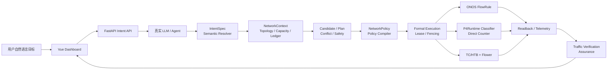
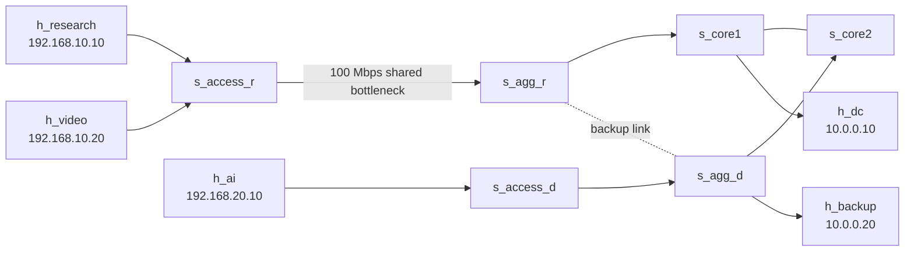

# NetPulse

## 基于大模型智能体的意图驱动网络系统

NetPulse 是一个将用户自然语言网络目标转换为**可审查、可执行、可读回、可验证**网络策略的实验型系统。它结合真实大模型智能体、ONOS 控制器、P4Runtime/可编程数据面、Mininet/BMv2 与 Linux TC/HTB，形成从业务意图到网络 QoS 证据的闭环。

用户不需要编写 FlowRule、P4Runtime 或 TC 命令。例如，用户可以表达“保障科研楼到数据中心的视频业务带宽不低于 30 Mbps”，系统会完成受约束的意图理解、必要澄清、网络感知、规划、安全与容量准入、策略编译、执行、南向读回、流量验证和对话式结果反馈。

> 安全边界：大模型负责理解和组织候选语义，**不直接执行 shell、P4 或 TC 命令**。所有网络写入均经过结构化 IntentSpec、ServiceProfile、冲突/安全检查、资源所有权、正式执行器与读回验证。

## 核心能力

| 能力 | 说明 | 当前交付状态 |
|---|---|---|
| Real LLM Intent Understanding | 自然语言解析为受 schema 约束的 IntentSpec | 依赖本地配置的真实 LLM 提供方 |
| Multi-turn Clarification | 缺少端点或业务 scope 时保存会话并请求补充 | 已实现 |
| Semantic Gating | 用 ServiceProfile、端点/协议/端口/DSCP 约束语义 | 已实现 |
| Network Context & Planning | 结合拓扑、路径、容量和资源账本生成 Candidate/Plan | 已实现 |
| Capacity & Conflict Admission | 在写入前进行冲突、安全和容量准入 | 已实现 |
| QoS Objectives | 支持 `MIN_BANDWIDTH`、`RATE_LIMIT`/上限等目标 | 已实现；实际 SLA 需现场流量复验 |
| ONOS + P4 + TC | 编译并执行 FlowRule、P4 classifier/counter 与 TC/HTB/flower | 已实现，需以真实读回为准 |
| Update & Idempotency | 管理版本、pending/commit、Binding、语义等价复用 | 已实现 |
| Formal Withdraw | 正式撤销当前 scope 的网络资源并保留审计历史 | 已实现 |
| Assurance & Evidence | 使用设备读回、计数器与流量测量形成可追溯证据 | 已实现；默认自动化开关见限制说明 |
| Dashboard Feedback | 展示对话结果、当前意图、等待/失败/生效状态和历史 | 已实现 |
| Priority / Preference | 提供优先级/偏好领域建模和决策支持 | **[仅测试覆盖/需单独真实负载验证]** |

## 系统架构



完整架构、状态机、更新、撤销和验证时序以 `idn-system/orchestrator/`、`idn-system/agents/` 与 `docs/FRONTEND_API_CONTRACT_MATRIX.md` 为准。

## 技术栈

- **Backend**：Python、FastAPI、领域模型与控制编排；
- **Frontend**：Vue 3、Vite、Dashboard 状态投影与对话交互；
- **Intent/Agent**：LLM adapter、Intent Understanding、Semantic Resolver、Planner、Conflict/Safety、Policy Compiler、Assurance；
- **Network Control**：ONOS、OpenFlow/FlowRule、P4Runtime、P4 direct counter、Linux TC/HTB/flower；
- **Network Testbed**：Mininet、BMv2、P4 程序；
- **Runtime**：Docker Compose、SQLite 持久化卷；
- **Validation**：pytest、前端测试、Vite 生产构建、南向 readback 和真实业务流量验证。

## 项目目录

```text
.
├── idn-system/              # FastAPI、Agent、控制面、模型、基础设施适配器与测试
├── frontend/                # Vue/Vite Dashboard 源码与前端测试
├── p4/                      # P4 程序源码与可重建的相关配置
├── mininet/                 # Mininet/BMv2 拓扑、启动器和实验网络源码
├── onos-pipeconf/           # ONOS Pipeconf 相关源码
├── docker/                  # 容器构建辅助材料
├── deploy/                  # Nginx 公网入口模板（占位符，不含凭据）
├── docs/                    # 前端接口契约与开源发布说明
├── scripts/                 # 启动、验证和发布辅助脚本
├── tests/                   # 发布工具测试
├── .github/workflows/       # 离线 CI 与手动网络集成
├── docker-compose.infra.yml # ONOS 与 Mininet/BMv2 基础设施编排
├── docker-compose.app.yml   # 后端与前端应用编排
├── .env.example             # 安全环境变量模板（无真实凭据）
├── LICENSE                  # Apache-2.0
└── .gitignore               # Git 发布排除规则
```

## 网络实验拓扑

拓扑源定义位于 `mininet/topologies/research_dc.yaml`。当前测试床包含：

| 类型 | 实例 |
|---|---|
| P4 交换机 | `s_core1`、`s_core2`、`s_agg_r`、`s_agg_d`、`s_access_r`、`s_access_d` |
| 主机 | `h_research`（`192.168.10.10/24`）、`h_video`（`192.168.10.20/24`）、`h_ai`（`192.168.20.10/24`）、`h_dc`（`10.0.0.10/24`）、`h_backup`（`10.0.0.20/24`） |
| 主要共享瓶颈 | `s_access_r` 到 `s_agg_r` 的 100 Mbps 链路 |
| 备份直连 | `s_agg_r` 到 `s_agg_d` 的 100 Mbps、5 ms 链路 |



实际路径、出口接口和 QoS class 必须由运行时 path resolver 决定；不要仅根据此图手工配置设备。

## 快速开始

### 环境要求

- Windows + WSL2 + Docker Desktop Linux Engine，或具备等价 Docker/privileged 容器能力的 Linux 主机；
- Docker Compose v2；
- 支持运行 Mininet/BMv2 与 ONOS 的本机资源；
- 可用的真实 LLM 提供方配置（仅存放在本地 `.env`）；
- 浏览器访问本地前端。

### 1. 配置本地环境变量

Linux/macOS：

```bash
cp .env.example .env
```

PowerShell：

```powershell
Copy-Item .env.example .env
```

然后仅在本机编辑 `.env`，填入你自己的认证材料和部署参数。不要提交 `.env`，不要将认证内容粘贴到 issue、日志、截图或 README。

### 2. 构建可重建的 P4 与 ONOS Pipeconf 工件

首次 clone 或 P4/Pipeconf 源码发生变化后，请在具备 Docker、P4 编译器以及 Maven/Java 环境的 WSL/Linux shell 中执行：

```bash
./p4/compile.sh
(cd onos-pipeconf && ./build.sh)
```

这两步会生成本地 P4 build 和 ONOS OAR 工件。它们是可重建的运行产物，已被 Git 忽略，不应提交。

### 3. 启动基础设施与应用

Linux/macOS：

```bash
docker compose \
  -f docker-compose.infra.yml \
  -f docker-compose.app.yml \
  up -d

docker compose \
  -f docker-compose.infra.yml \
  -f docker-compose.app.yml \
  ps
```

PowerShell：

```powershell
docker compose `
  -f docker-compose.infra.yml `
  -f docker-compose.app.yml `
  up -d

docker compose `
  -f docker-compose.infra.yml `
  -f docker-compose.app.yml `
  ps
```

项目必须同时使用这两个 Compose 文件；不要用单独的 `docker compose up` 代替。

### 4. 打开服务

| 服务 | 地址 |
|---|---|
| Dashboard | `http://localhost:5173/dashboard` |
| Backend API | `http://localhost:8000/api/v1` |
| Swagger/OpenAPI | `http://localhost:8000/docs` |
| ONOS | `http://localhost:8181` |
| Mininet topology service | `http://localhost:9001` |

认证账户由本地部署配置和系统管理员管理；本 README 不记录任何凭据。

## 使用示例

### 完整业务意图

```text
保障科研楼到数据中心的视频业务带宽不低于 30 Mbps
```

推荐在 Dashboard 中提交。系统应依次形成 IntentSpec、NetworkContext、Candidate、Agent Decision、Conflict/Safety 结果、IntentPlan、NetworkPolicy 与 Execution。最终需同时查看：

1. 当前 policy、generation、pending 状态和唯一 active ResourceBinding；
2. ONOS 中的精确 FlowRule selector；
3. Direct P4Runtime 中的 classifier 与 direct counter；
4. path resolver 所确定出口上的 TC/HTB class 和 flower filter；
5. 真实业务与竞争流量下的 receiver throughput、loss/jitter、P4/TC counter delta；
6. Assurance、Intent lifecycle 和 Dashboard 状态的一致性。

### 信息不足时的澄清

```text
保障 A 点到 B 点的带宽大于 10 Mbps
```

端点或业务 scope 不够明确时，系统应进入等待澄清，而不是自动猜测具体流。用户补充 source、destination 或业务信息后，应在同一会话/意图上下文中继续处理。

### 最大带宽限制

```text
把备份数据流量封顶在 20 兆以内。
```

该类请求应被解析为受约束的 `MAX_BANDWIDTH`/RATE_LIMIT 业务目标。验证时应证明 TC class/filter、P4 classifier、ONOS flow 和 TCP 测量均与当前 policy 一致。

## 测试与验收

离线检查（与 CI 一致）：

```bash
# 后端（P4 相关用例需要先生成 P4Info）
(cd idn-system && pip install -r requirements.txt)
./p4/compile.sh
(cd idn-system && python -m pytest -q -m 'not integration')

# 前端
(cd frontend && npm ci && npm test && npm run build)
```

真实网络与真实 LLM 验收需要目标实验环境，按 [开源发布说明](docs/operations/open-source-release.md) 和 `.github/workflows/network-integration.yml` 执行。单元测试、控制器 ACK 或前端文案不等价于真实 E2E。

## 文档

- [前端接口契约矩阵](docs/FRONTEND_API_CONTRACT_MATRIX.md)
- [开源发布与导出流程](docs/operations/open-source-release.md)
- [生产环境 E2E 验收记录](docs/PRODUCTION_E2E_TEST_REPORT.md)
- [第三方依赖与发布授权](THIRD_PARTY_NOTICES.md)
- [贡献指南](CONTRIBUTING.md)
- [安全策略](SECURITY.md)

## 安全与设计原则

- LLM 不能绕过 IntentSpec、Semantic Resolver、Conflict/Safety、capacity admission 与 policy compiler；
- 用户未明确端点时不推断具体 traffic scope；
- 容量不足时拒绝，并验证没有 Policy、Binding、ONOS、P4 或 TC 残留；
- 更新后必须检查 pending cleared、current policy、唯一 active binding 与 Resident stability；
- 语义幂等请求可产生业务审计记录，但不应重复创建数据面资源；
- 正式撤销应使对象离开 Current，同时保留 History/Audit；
- 任何真实网络恢复均经 NetworkReconciler、lease/fencing 和正式 actuator 路径处理。

## 已知限制

- 吞吐结果会受到 Docker Desktop/WSL、宿主机 CPU、虚拟网络和当前资源容量影响；每次展示需重新预检与测量。
- watcher、自动 assurance、probe scheduler 和 fault controller 是可选能力，默认关闭，不能宣称为默认持续自治运维。
- 真实 LLM 可用性依赖外部 provider、区域/workspace、网络和认证配置；失败时不能用 mock/fallback 冒充真实调用。
- 优先级/偏好、复杂多意图和故障注入的长期真实网络验证仍需持续扩展。

## License

本项目自有源码采用 [Apache-2.0](LICENSE)。第三方依赖、镜像和工具保留各自许可，详见 [第三方依赖与发布授权](THIRD_PARTY_NOTICES.md)。复用与二次分发请遵循许可证条款。
